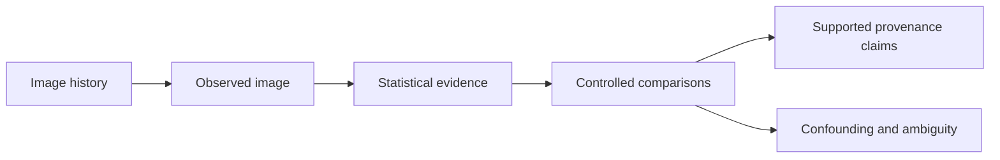

<div align="center">

# PalimTrace

**Statistical Forensics of Image Generation Histories**

[](VERSION)
[](docs/research-status.md)
[](experiments/phase-dependence/README.md)

English · [简体中文](README.zh-CN.md)

[Research](docs/research-index.md) · [Experiment](experiments/phase-dependence/README.md) · [Reproduce](#reproduce)

</div>

## Research scope

PalimTrace investigates the statistical traces left by image synthesis, neural reconstruction, watermark embedding and subsequent processing. Its central question is which observations support a specific claim about an image's production history, and under what conditions that claim remains identifiable.



| Research direction | Focus |
| --- | --- |
| Generative fingerprints | Mechanism-specific evidence across models and image content |
| Digital watermarking | Signal preservation, detection and robustness |
| Statistical forensics | Multiscale dependencies, periodic structure and processing confounds |
| Provenance identifiability | Evidence limits and uncertainty under competing histories |

## Initial experiment: cross-scale phase dependence

The initial experiment measures conditional correlation between fine and coarse Haar detail energies over a 4 × 4 sampling phase grid. Phase averaging is invariant to circular integer translation under the stated grid conditions.

| Public example | Mean dependence | Phase range |
| --- | ---: | ---: |
| Stable Diffusion output 2 | 0.8635 | 0.0493 |
| Stable Diffusion output 3 | 0.8667 | 0.0427 |
| BDD100K source frame | 0.9106 | 0.1322 |
| UCF source frame | 0.8673 | 0.0877 |

**Observation.** In seven convenience images, the maximum circular-shift error of the phase mean was 6.66 × 10⁻¹⁶. Genuine camera-source images can exhibit stronger phase variation than generated examples. These measurements characterize the feature, not detection accuracy or origin probabilities.

[Method and limitations](experiments/phase-dependence/README.md) · [Measurements](experiments/phase-dependence/results.csv) · [Source manifest](experiments/phase-dependence/sources.csv)

## Reproduce

```bash
git clone https://github.com/Alioth-31/PalimTrace.git
cd PalimTrace
python -m pip install -r requirements.txt
python experiments/phase-dependence/phase_profile.py --download
```

Source images are not redistributed. Review source permissions before downloading. The script checks Git blob hashes and records failures; the original measurements used JavaScript decoders, so Pillow results may differ slightly.

## Repository

```text
PalimTrace/
├── README.md
├── README.zh-CN.md
├── VERSION
├── requirements.txt
├── docs/
├── experiments/
│   └── phase-dependence/
└── data/
```

See the [research index](docs/research-index.md), [research status](docs/research-status.md), [version policy](docs/versioning.md) and [data and privacy policy](docs/privacy.md).

## Status and rights

Version 0.1.0 is an exploratory research baseline, not a validated universal image detector. No open-source license has been granted. Third-party material remains subject to its original terms.
