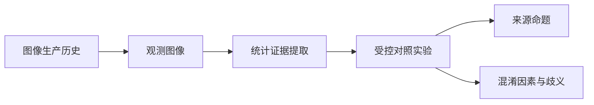

<div align="center">

# PalimTrace

**图像生成历史的统计取证研究**

[](VERSION)
[](docs/research-status.md)
[](experiments/phase-dependence/README.md)

[English](README.md) · 简体中文

[研究方向](docs/research-index.md) · [实验](experiments/phase-dependence/README.md) · [复现](#实验复现)

</div>

## 研究定位

PalimTrace 研究图像合成、神经重构、水印嵌入及传播处理留下的统计痕迹。核心问题是：图像观测证据能够支持哪些关于生产历史的判断，以及这些判断在什么条件下仍然具有可辨识性。



| 研究方向 | 研究对象 |
| --- | --- |
| 生成指纹 | 跨模型、跨内容的机制特异性证据 |
| 数字水印 | 信号保留、检测及鲁棒性 |
| 统计取证 | 多尺度依赖、周期结构与处理混淆 |
| 来源可辨识性 | 竞争性图像历史下的证据边界与不确定性 |

## 初始实验：跨尺度依赖相位分析

在 4 × 4 分析格点相位上计算粗、细尺度 Haar 细节能量的条件相关系数。在指定格点及循环边界条件下，相位平均具有整数平移不变性。

| 公开样例 | 平均依赖 | 相位极差 |
| --- | ---: | ---: |
| Stable Diffusion 生成结果 2 | 0.8635 | 0.0493 |
| Stable Diffusion 生成结果 3 | 0.8667 | 0.0427 |
| BDD100K 真实画面 | 0.9106 | 0.1322 |
| UCF 真实画面 | 0.8673 | 0.0877 |

**实验观察：** 七张便利样例的相位平均在循环平移下的最大数值误差为 6.66 × 10⁻¹⁶。真实采集图像也可能呈现更强的相位波动。该实验描述特征性质，不估计检测准确率或生成概率。

[实验方法与限制](experiments/phase-dependence/README.md) · [统计结果](experiments/phase-dependence/results.csv) · [来源清单](experiments/phase-dependence/sources.csv)

## 实验复现

```bash
git clone https://github.com/Alioth-31/PalimTrace.git
cd PalimTrace
python -m pip install -r requirements.txt
python experiments/phase-dependence/phase_profile.py --download
```

仓库不再分发第三方原图。下载前核查来源许可。程序校验 Git blob 哈希并记录失败样本；原始统计采用 JavaScript 解码器，Pillow 的复现结果可能存在细微差异。

## 目录结构

```text
PalimTrace/
├── README.md
├── README.zh-CN.md
├── VERSION
├── requirements.txt
├── docs/                         # 研究及管理文档
├── experiments/
│   └── phase-dependence/         # 跨尺度依赖相位实验
└── data/                         # 本地数据入口
```

[研究索引](docs/research-index.md) · [研究状态](docs/research-status.md) · [版本规范](docs/versioning.md) · [数据与隐私](docs/privacy.md)

## 研究状态与权利

0.1.0 为探索性研究基线，尚非经过通用验证的图像检测器。项目暂未授予开源许可证，第三方材料遵循原许可条件。
